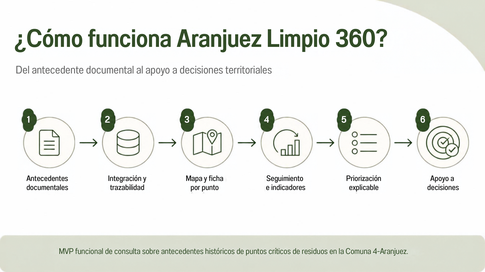
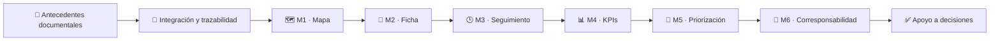
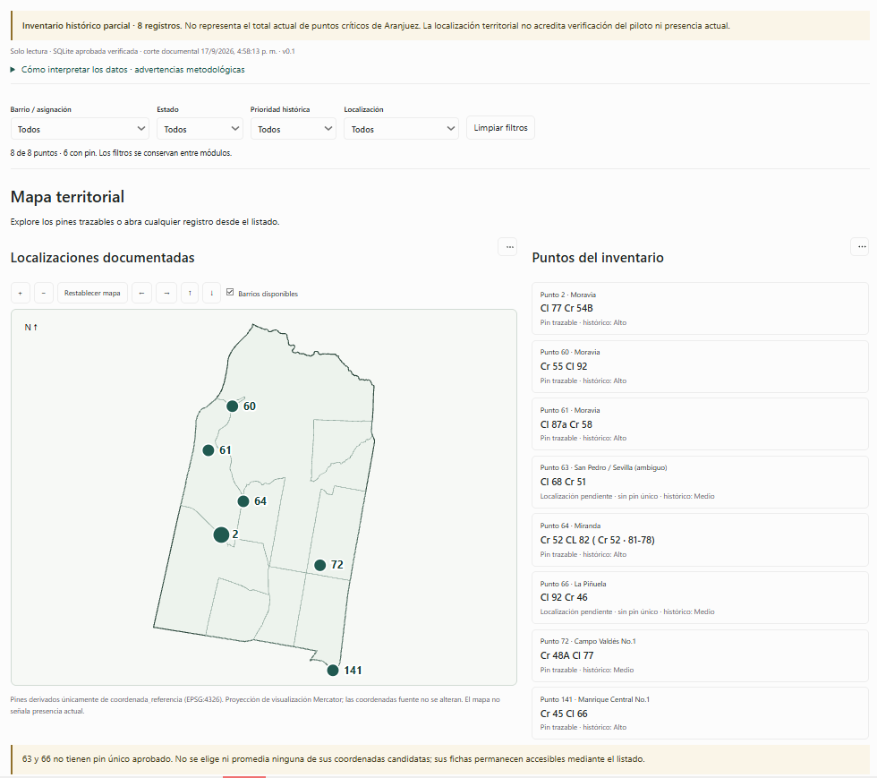
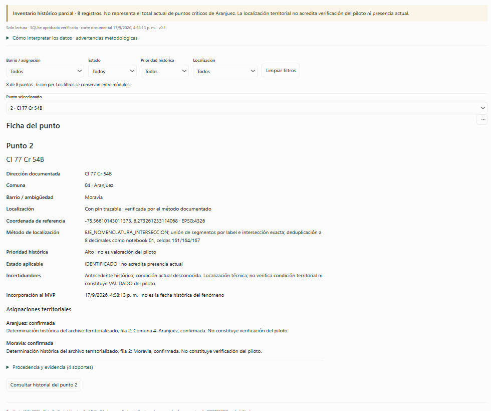
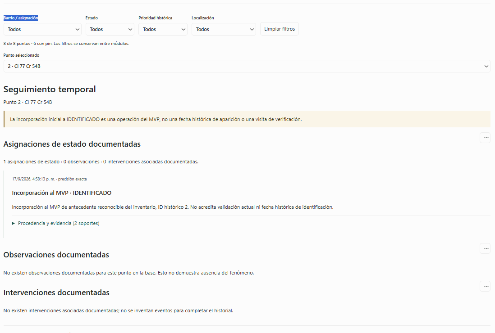
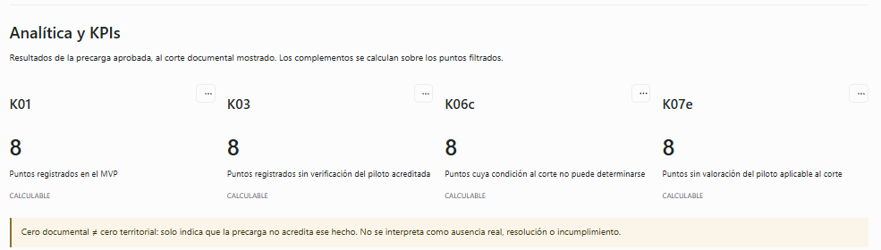
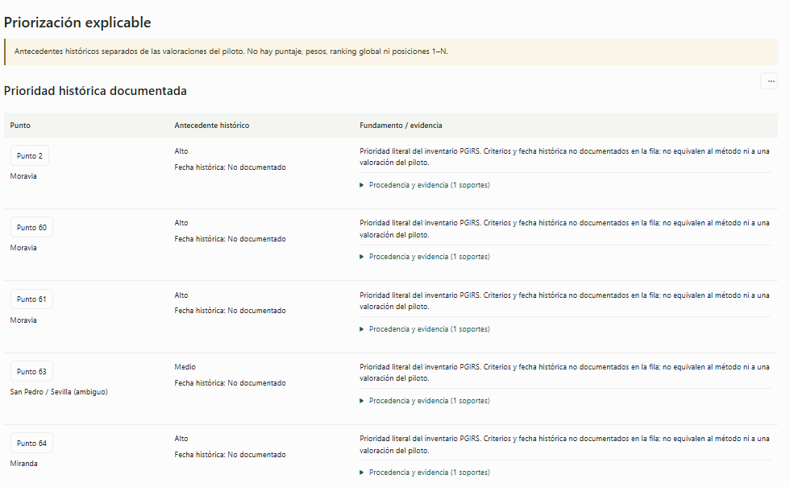
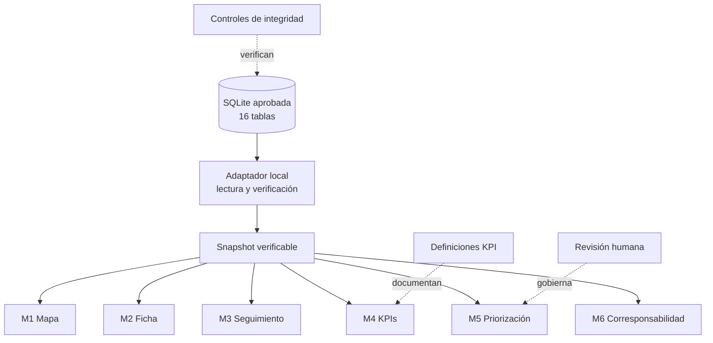
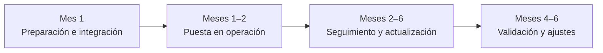

# ♻️ Aranjuez Limpio 360
### Inteligencia microterritorial para el seguimiento y priorización de puntos críticos de residuos

**Comuna 4 — Aranjuez · Medellín · Territorio INN 2026**

> **Del antecedente disperso a una decisión mejor informada, sin inventar evidencia.**

## 🌱 ¿Qué problema resuelve?

La información sobre puntos críticos de residuos puede existir en distintas fuentes, con niveles de precisión y trazabilidad diferentes. Cuando esos registros se consultan de forma aislada, resulta difícil reconstruir **qué se sabe de cada punto, qué no está confirmado y qué información puede usarse para orientar una priorización**.

**Aranjuez Limpio 360** organiza esa evidencia en una experiencia de consulta territorial que integra mapa, ficha por punto, seguimiento, indicadores y priorización explicable.

La propuesta parte de una regla sencilla: **mostrar lo que la evidencia permite afirmar y hacer visible lo que todavía no puede afirmarse.**

---

## ✨ La solución, en 30 segundos

| Lo que hace | Cómo lo hace |
|---|---|
| **Ubica antecedentes** | Visualiza únicamente los registros con ubicación puntual trazable. |
| **Explica cada punto** | Conserva dirección, localización, prioridad histórica, estado e incertidumbres. |
| **Conserva memoria documental** | Separa antecedentes, estados, observaciones e intervenciones registradas. |
| **Resume el conjunto** | Calcula KPIs sobre la precarga aprobada y explicita sus límites. |
| **Apoya priorización** | Presenta criterios y evidencia sin ranking automático ni decisión cerrada. |

---

## 🧭 Así se usa el MVP

### 1. Ubicar un antecedente

En **M1 · Mapa**, el usuario explora los puntos con ubicación puntual y también puede consultar el inventario completo.

### 2. Abrir su ficha

En **M2 · Ficha**, el punto seleccionado conserva su contexto: dirección documentada, localización, prioridad histórica, estado e incertidumbres.

### 3. Revisar su trazabilidad

En **M3 · Seguimiento**, el sistema muestra lo documentado en el tiempo. Si no existen observaciones o intervenciones asociadas, lo informa explícitamente en lugar de completar vacíos artificialmente.

### 4. Analizar el conjunto

En **M4 · KPIs**, los registros se convierten en indicadores interpretables bajo reglas metodológicas explícitas.

> **Cero documental ≠ cero territorial.** La ausencia de evidencia en la precarga no prueba que el fenómeno no exista en el territorio.

### 5. Apoyar la priorización

En **M5 · Priorización**, los antecedentes históricos y su fundamento documental se presentan de forma separada de futuras valoraciones del piloto.

> **Sin puntaje oculto · sin pesos · sin ranking 1–N · con revisión humana.**

---

## 🔎 Qué hace diferente a Aranjuez Limpio 360

| Principio | Aplicación en el MVP |
|---|---|
| **No inventar ubicación** | 6 antecedentes tienen pin trazable; 2 permanecen consultables sin coordenada única aprobada. |
| **No confundir historia con actualidad** | `IDENTIFICADO` es un estado de incorporación al MVP y no acredita presencia actual. |
| **No convertir vacío documental en ausencia real** | Los indicadores distinguen entre información disponible, no aplicable y no verificable. |
| **No automatizar decisiones humanas** | La priorización organiza evidencia y criterios; no produce un ranking automático. |
| **No vender una validación inexistente** | Las pruebas realizadas son técnicas e internas, no validación comunitaria o institucional. |

---

## 📌 Alcance actual

- **8 antecedentes históricos mínimos** incorporados a la precarga.
- **6 antecedentes con pin trazable**.
- **2 antecedentes sin pin único aprobado**: permanecen en el inventario sin fabricar coordenadas.
- Consulta local mediante **SQLite en modo solo lectura**.
- Módulos funcionales **M1–M6**.
- No incorpora predicción, clasificación mediante ML ni asignación automática de recursos.
- No representa un censo actual de todos los puntos críticos de la Comuna 4.

---

## 🧪 Validación técnica

La revisión técnica del MVP v0.1 cerró sin defectos bloqueantes dentro del alcance probado.

| Evidencia | Resultado |
|---|---:|
| Tareas técnicas de revisión | **16 / 16 exitosas** |
| Comprobaciones de navegador | **68 satisfactorias** |
| Errores JavaScript | **0** |
| Registros preservados | **8** |
| Pines trazables preservados | **6** |
| Archivos listados en manifiesto final | **321** |
| Modo de acceso a SQLite | **Solo lectura** |

Las pruebas se ejecutaron en escritorio y en emulación móvil. No participaron usuarios externos; por tanto, esta evidencia corresponde a **validación técnica**, no a validación territorial o comunitaria.

➡️ [Ver detalle de validación](docs/VALIDACION_TECNICA.md)

---

## 🏗️ Arquitectura conceptual

El MVP trabaja sobre una base aprobada y realiza consultas en modo de solo lectura. La visualización no modifica la fuente operativa.

➡️ [Arquitectura y trazabilidad](docs/ARQUITECTURA_Y_DATOS.md)

---

## 🖥️ Ejecutar el MVP en Windows

1. Descargar el paquete final para Windows.
2. Extraer completamente el ZIP.
3. Entrar a `Aranjuez_Limpio_360_MVP_FINAL`.
4. Ejecutar `ABRIR_MVP.bat`.
5. Mantener la consola abierta y acceder a `http://127.0.0.1:8765`.

No se requiere Node.js, servidor de base de datos ni conexión a servicios de mapas para la consulta local del paquete entregado.

➡️ [Instrucciones completas](mvp/INSTRUCCIONES_WINDOWS.md)

---

## 🎬 Entregables y demo

| Recurso | Enlace |
|---|---|
| 📄 **Propuesta final** | [Abrir PDF](https://drive.google.com/file/d/1zZ0y1PpG9Oils8i28zTPqPgaMfamWiE4/view) |
| 🖼️ **Presentación del funcionamiento** | [Abrir presentación](https://drive.google.com/file/d/1crAA-ZFtUzR5eUq00Cw58EX5AEkE0h3x/view) |
| 🎥 **Video pitch** | [Ver video](https://drive.google.com/file/d/1sgSOAfK-qGabxApwYLnLMDVSofqcXR3R/view) |
| 💻 **MVP final para Windows** | [Descargar paquete](https://drive.google.com/file/d/1NQJx65ahbfFShKf_YYIyFAUtxJKlYgsT/view) |
| 📁 **Carpeta general de entrega** | [Abrir Drive](https://drive.google.com/drive/folders/1lh-MDJgDIx3YEYpM0dT403jJ7AmStww9) |

---

## 🧭 Del MVP al piloto

El MVP actual es una herramienta de consulta sobre antecedentes históricos. El piloto propuesto permitiría avanzar hacia captura controlada, seguimiento territorial y validación de utilidad/usabilidad sin borrar la separación entre **dato documentado, dato por verificar y decisión humana**.

---

## ⚠️ Límites que el proyecto hace explícitos

Este repositorio no presenta como hechos aquello que todavía requiere validación territorial.

- Los **8 registros son un mínimo documental**, no el total actual de puntos críticos.
- Una **prioridad histórica** no equivale a una valoración del piloto.
- `IDENTIFICADO` no acredita presencia actual del fenómeno.
- La ausencia de observaciones o intervenciones registradas no prueba que no hayan ocurrido fuera de la evidencia disponible.
- El MVP no reemplaza un censo oficial, la validación comunitaria ni el criterio institucional.

➡️ [Leer límites y reglas de interpretación](docs/LIMITACIONES_Y_REGLAS.md)

---

## 👤 Autor y contexto académico

**Kevin Andrés Garcés Echeverri**  
Ingeniería en Telecomunicaciones · Instituto Tecnológico Metropolitano — ITM  
Proyecto desarrollado para **Territorio INN 2026 — Reto 5 · Medio Ambiente · Comuna 4–Aranjuez**.

---

### Aranjuez Limpio 360
**Información trazable. Priorización explicable. Decisiones humanas mejor informadas.**

