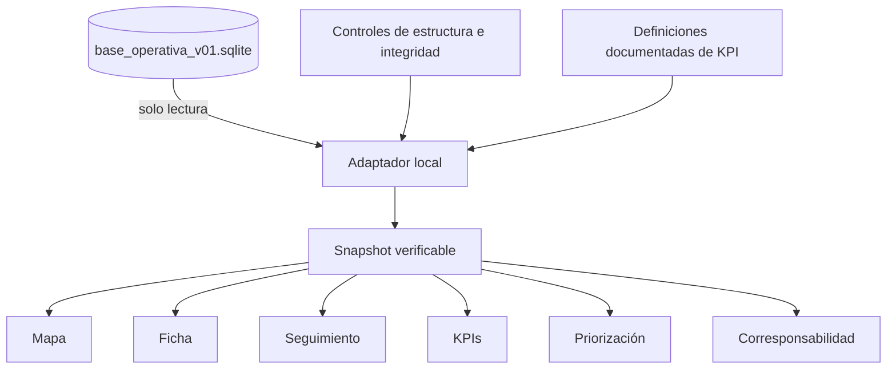

# Arquitectura y trazabilidad de datos

## Principio de diseño

Aranjuez Limpio 360 separa la **fuente operativa aprobada**, la **capa de adaptación/verificación** y la **capa de presentación**. El objetivo es que la experiencia visual no transforme silenciosamente la evidencia de origen.

## Reglas de trazabilidad

1. **No se generan coordenadas nuevas** para registros cuya fuente no tiene una ubicación única aprobada.
2. La identidad histórica de cada antecedente se conserva mediante controles específicos.
3. Las fechas de carga o incorporación al MVP no se presentan como fechas históricas del fenómeno.
4. La prioridad del inventario de referencia se presenta como **prioridad histórica**, no como decisión actual del piloto.
5. Las consultas del dashboard no escriben sobre la SQLite aprobada.

## Cobertura documental del MVP

El corte actual incorpora ocho antecedentes históricos mínimos. Seis cuentan con ubicación puntual trazable y dos permanecen consultables sin pin único aprobado.
